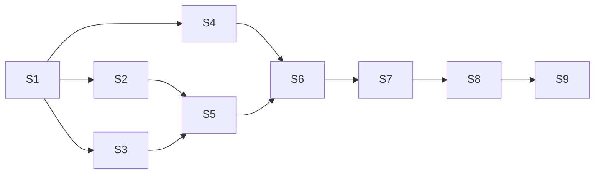

# Epic: PetsTown hackathon

## Overview

Deliver a local browser office for existing Codex agents, with genuine pets and presenter-controlled choreography. The first complete live checkpoint includes inspection and one authentic water-cooler handoff. Direct replies follow; voice and a live computer view are later gates.

Authoritative inputs:
- [Experience design](../../../design.md)
- [PRD and user stories](../../prds/petstown-hackathon.md)
- [Shared office contract](../../../docs/contracts/office-v1.md)
- [Integration evidence and limitations](../../../docs/integration-notes.md)
- [Reconciled colleague discussion](../../../docs/colleague-reconciliation.md)

## Architecture Decisions

Follow ADRs 0001–0003: observe existing work, launch a local browser, and keep Start the day independent of execution. Use the office contract as the boundary between native Codex protocol, local state and rendering. No new scheduler, cloud backend or database is required.

Implementation proposal: a TypeScript workspace with a local Node bridge, React UI and Canvas 2D office renderer. A launcher skill starts or reuses the loopback server and opens the browser; exact invocation is validated during packaging. Keep protocol details inside the adapter so live discovery limitations do not leak into scene logic.

## Three owner lanes

These are teammate roles, not three horizontal implementation tickets. Each numbered slice delivers a complete observable path and has one accountable owner.

| Lane | Teammate role | Primary slices | Stewardship |
| --- | --- | --- | --- |
| A | Office/pet visual lead; prototype owner is a natural fit | S2, S5; visual support for S1/S4/S8 | src/office, scene geometry, asset manifests, assets/office |
| B | Codex integration lead; the colleague volunteered for this | S1, S4, S7 | src/codex, normalized event mapping, request and handoff evidence |
| C | App and demo integration lead; third teammate | S3, S6, S8, S9 | src/server, src/ui, launcher, repository integration, demo runbook |

Lane C owns shared entrypoint/package changes and integration of contracts. A slice may change another module when needed for its end-to-end behavior; coordinate with its steward. Ownership is not a rule that requires handing incomplete layers between people.

Before fan-out, all three align on contract v1 and the first real trace. Then A starts S2, C starts S3 and B starts S4 in parallel. After that, A completes S5 while C prepares the demo integration and B prepares response feasibility evidence. Closure follows the dependency graph below.

## Technical Approach

### Frontend

- Render the generated office background with genuine Codex pet sprite overlays.
- Scene geometry is explicit; the PNG is not a navigation or collision map.
- A ready screen, Start the day, skip and reset manage presentation state.
- Separate choreography, project layout, pet rendering and detail-panel components to reduce simultaneous edits.
- Factual bubbles use visible agent summaries. Decorative gestures do not invent collaboration.
- More than four projects must remain possible despite the illustrated desk count.

### Backend and adapter

- Observe already-running sessions using the supported local runtime connection verified by S1.
- Maintain stable identity, parent/project mapping, pending requests and handoff deduplication.
- Serve snapshots plus ordered SSE events. Route only supported, correlated request replies.
- Expose capability and connection health explicitly; unsupported does not mean successful.
- Bind to loopback and validate state-changing browser requests. Keep credentials out of the frontend.

### Infrastructure and reuse

- Everything runs on one Mac. No hosted service is needed for the first checkpoint.
- Existing agency renderer code is a selective reuse candidate; retain applicable attribution.
- Current repository contains documentation and a generated environment only. Do not assume an existing app scaffold.
- The repo currently has no commits. Publish an initial agreed documentation/assets snapshot before teammates start branches or worktrees. Exclude personal .vscode settings.
- Prepare the three demo agents outside PetsTown; neither the launcher nor Start the day creates work.

## Approved vertical slices

IDs below are planning IDs, not GitHub issue numbers. The user approved all nine slices and their dependencies for publication with needs-triage. Human interaction means live environment/design validation, not an extra publication gate.

### S1 — Open Office and see one existing agent as a genuine pet

- **Type:** HITL
- **Owner:** B, with A supplying the asset mapping and C the minimal launcher/shell.
- **Blocked by:** None.
- **Stories:** US01, US03, foundational US08.
- **What to build:** A supported CLI launch opens a minimal local office showing one genuine pet tied to an already-running Codex agent. Prove the actual runtime and asset path before other work relies on it.
- **Acceptance criteria:**
  - Launch from a documented supported skill or executable path; no claim that bare /office is registered unless tested.
  - Display the existing agent identity and a real observed activity/status change through adapter → bridge → browser → pet.
  - Load a genuine ChatGPT/Codex asset, record its origin/format, and show a real animation frame sequence. No substitute art.
  - Launching, observing and closing the view do not create, restart, pause or terminate the underlying agent.
  - Establish shared contract v1, a labelled development trace, and a sanitized real observation trace.
  - Record whether existing requests and authentic cross-agent exchanges are observable. Record unsupported capability honestly.
  - If passive observation or native assets cannot be established, report the precise blocker; do not silently change to office-owned agents or fake pets.
- **Verification:** One live run on the intended runtime, asset inspection and a targeted adapter/contract regression check.
- **Size:** M; highest uncertainty. Start with a short proof, not the entire polished office.

### S2 — Start the day, watch arrivals and standup, then follow work locations

- **Type:** AFK
- **Owner:** A.
- **Blocked by:** S1.
- **Stories:** US02, US03, US09.
- **What to build:** Existing live agents become a presenter-controlled opening and then activity-driven pets in the office.
- **Acceptance criteria:**
  - Office opens ready; Start the day is the only automatic ceremony trigger.
  - Pets arrive individually, main pets give brief factual updates, subagents are summarized, and skip advances to live work.
  - Current events continue updating during the ceremony; neither it nor skip affects Codex work.
  - Observed activity drives desks/quiet spots/sofas; verified completion celebrates then rests; closed sessions leave.
  - A separate water-cooler prop and waypoint match the office style without generating pet characters.
  - Geometry keeps pets on sensible paths; repeated Start clicks do not duplicate the ceremony or pets.
  - A small scene interface supports independent handoff choreography from S4 without requiring S4 to wait for visual polish.
- **Verification:** Browser interaction with live snapshots and controlled event traces; inspect the actual rendering at demo resolution.
- **Size:** M.

### S3 — Click a pet to inspect live activity and outstanding requests

- **Type:** AFK
- **Owner:** C.
- **Blocked by:** S1.
- **Stories:** US05, visibility portion of US07, US08.
- **What to build:** Selecting an existing pet opens its current task, recent visible activity and real pending request details.
- **Acceptance criteria:**
  - Selection uses stable agent identity and survives state changes.
  - The panel shows the correct agent, task and recent activity; missing facts are explicit.
  - A real unresolved request creates !; clicking, fading and scene reset do not clear it.
  - Resolution from the original Codex client updates the panel and clears the matching request only.
  - If only a waiting flag is observable, show details unavailable instead of inventing a prompt.
  - Distinguish agent failure from bridge disconnection and stale data.
  - Direct reply controls remain disabled with an explanation until S7 proves that capability.
- **Verification:** One real pending/resolved request plus browser checks for selection, missing details and reconnect.
- **Size:** M.

### S4 — Turn a real agent handoff into a water-cooler meeting

- **Type:** AFK
- **Owner:** B, with A reviewing scene integration.
- **Blocked by:** S1.
- **Stories:** US06, US09.
- **What to build:** Observe an actual exchange between two existing agents, publish its correlation through the contract and animate the corresponding pair meeting and returning to work.
- **Acceptance criteria:**
  - A real source event identifies both participants and supports the displayed summary; proximity or a timer cannot create a handoff.
  - A stable handoff ID reaches the browser and produces one meeting per exchange.
  - Text bubbles describe the real exchange; the real handoff proceeds independently of animation.
  - Overlapping handoffs queue without placing one pet in two meetings; failure or closure cancels obsolete choreography.
  - Reconnect/replay does not duplicate the meeting.
  - A minimal pair movement is demoable independently; it composes with S2's final scene without replacing its choreography.
  - Capture a sanitized real trace. A fixture-only meeting does not satisfy acceptance.
- **Verification:** Trigger a genuine exchange in the externally prepared demo cohort and inspect the live event-to-animation path.
- **Size:** M; depends on observed runtime capabilities, not on fabricating an exchange.

### S5 — Keep multiple project areas and subagent groups readable

- **Type:** AFK
- **Owner:** A.
- **Blocked by:** S2, S3.
- **Stories:** US04, US07 visibility.
- **What to build:** Real project/parent relationships control areas, optional subagent visibility and readable overflow.
- **Acceptance criteria:**
  - One open-plan office contains distinct labelled project areas, not separate rooms.
  - Both main and subagents show by default; a global toggle hides subagents without affecting their work.
  - Crowded groups collapse into expandable counts using stable parent identities.
  - Hidden agents with pending requests leave visible group attention and can be inspected.
  - Layout supports more than four projects; the background's four desk clusters are not a cap.
  - Joining/leaving agents and unknown parents do not duplicate or orphan pets.
- **Verification:** Browser trace with at least six projects and a ten-subagent group, plus a live parent/subagent mapping check. Clearly distinguish fixture stress coverage from live coverage.
- **Size:** M.

### S6 — Package and rehearse the resilient 90-second live office

- **Type:** HITL
- **Owner:** C; all three verify their contributions.
- **Blocked by:** S4, S5.
- **Stories:** US01–US06, US08–US09 integrated.
- **What to build:** A reproducible local launch and scene reset that brings the core slices together on the demo Mac.
- **Acceptance criteria:**
  - A teammate follows the runbook from the shared checkout and opens the office with three externally prepared real agents.
  - Start the day → arrivals → standup → live inspection → real water-cooler handoff fits a rehearsed 90-second sequence.
  - Browser refresh, office reset and repeat launch preserve agent execution; the bridge is reused rather than duplicated.
  - A disconnect shows lost contact, then resynchronizes without duplicate pets, requests or meetings.
  - A failed agent retains an honest failed state while working pets continue; no silent replay substitution.
  - Record the tested build, runtime, exact invocation, asset setup and live evidence. Save a known-working checkpoint.
  - Plugin packaging, if selected, is installed and its actual skill completion/invocation tested rather than merely copied into a folder.
- **Verification:** Actual browser demo on the target Mac plus targeted reconnect/duplicate-event tests and runbook execution.
- **Size:** M. This is the first complete demo checkpoint.
- **Human gate:** The team rehearses and accepts the integrated presentation on the actual demo Mac.

### S7 — Answer an existing agent's request from its pet panel

- **Type:** HITL
- **Owner:** B, with C integrating the panel controls.
- **Blocked by:** S6.
- **Stories:** US07.
- **What to build:** A browser response reaches and resolves the intended existing Codex request, with live request-ownership verification.
- **Acceptance criteria:**
  - Establish supported request replay/access and response ownership for a second view; do not treat normal chat input as approval.
  - Correctly bind agent ID, request ID, request type and any revision to the response.
  - Submit the appropriate answer once; duplicate clicks, stale requests and original-client resolution have explicit outcomes.
  - A submission acknowledgement does not clear !; observed source resolution does.
  - Demonstrate a real pending request answered in the office and continued agent progress where applicable.
  - If an outstanding request cannot be answered through a supported route, retain inspection and raise the limitation; navigation to another client does not pass this slice.
- **Verification:** Live controlled request on the demo runtime, including one stale/already-resolved case and correlation tests.
- **Size:** M/high uncertainty.
- **Dependency note:** S6 is a deliberate product-priority gate; response feasibility can be investigated earlier without claiming delivery.

### S8 — Add optional voice to factual pet updates

- **Type:** AFK
- **Owner:** C, with A reviewing presentation.
- **Blocked by:** S7.
- **Stories:** US10.
- **What to build:** Optional OpenAI voice speaks the same factual standup/handoff text while the text experience remains complete.
- **Acceptance criteria:**
  - Verify current official API/model capabilities at implementation time; no model or credential access is assumed from planning.
  - Speech remains grounded in the existing text, with a mute control and bounded queues.
  - Audio failures do not stop the office or falsify work status.
  - Demo setup documents any credentials and browser audio gesture requirements without exposing secrets.
- **Verification:** Live audio in the intended browser, mute/failure checks and a timed demo pass.
- **Size:** M; stretch only.
- **Dependency note:** Voice after replies is the agreed checkpoint order, not an inherent API dependency.

### S9 — Inspect an agent's associated live computer view

- **Type:** HITL
- **Owner:** C.
- **Blocked by:** S8.
- **Stories:** US11.
- **What to build:** From a pet/desk, open a genuinely associated browser or terminal view when the runtime provides one.
- **Acceptance criteria:**
  - Verify a supported view source and its association with the correct agent.
  - Clearly identify whether the view is live; unavailable views do not show a misleading recording.
  - Preserve the normal pet detail panel and office navigation.
  - Do not broaden agent permissions or expose unrelated sessions to supply this feature.
- **Verification:** One real associated view on the demo Mac and an unavailable-view case.
- **Size:** L/uncertain; last stretch gate.

## Dependency graph

## Parallelization and merge discipline

S2/S3/S4 can proceed simultaneously after S1 using separate modules. During that wave, A owns general scene/choreography, B owns adapter and the handoff module, and C owns the panel/server integration. Their shared interfaces and fixtures are agreed in S1. New event shapes require a contract update reviewed by the integration owner.

S5 follows S2/S3 because it combines scene layout and attention visibility. S6 is an integration behavior slice, not a late attempt to connect separately invented layers. Each earlier slice is already end to end and merges with its own checks. S7–S9 preserve user-chosen priority.

## Effort and checkpoints

The five-hour envelope is historical planning context. It is not a promise that all nine slices fit, nor a running timer. Work toward the complete text checkpoint first; keep adding independently verified capabilities afterwards, with a known-working revision after each merge and a short demo run between additions. Do not impose a one-hour feature freeze that the colleague explicitly rejected.

Suggested initial allocation: jointly prove one live pet and the contract, then spend the largest parallel block on S2/S3/S4; combine grouping and resilience into the first complete checkpoint. Replies receive the next available block, voice follows, and the computer view is last. No later slice is counted complete because time ran out.

## Publication and acceptance boundaries

The tracker is JackInSightsV2/Pets-Town on GitHub; Issues are enabled. needs-triage was absent on inspection and must be created at publication if still absent. Do not invent existing issue numbers or parent links.

The user invoked to-issues and approved the concrete slice breakdown. Publish in dependency order, use real issue identifiers for blockers, and include each slice's scope, acceptance, stories, owner lane and evidence boundary. Do not silently assign guessed GitHub users.

Implementation acceptance requires observed behavior. A generated image, compiling code, a fixture replay or a package folder alone is not proof of a working live office.
